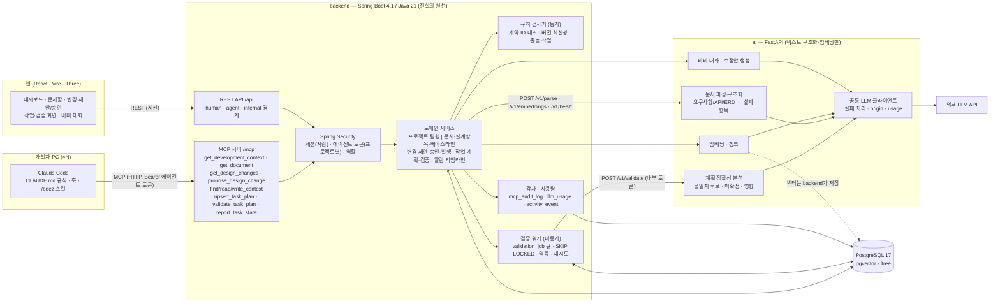
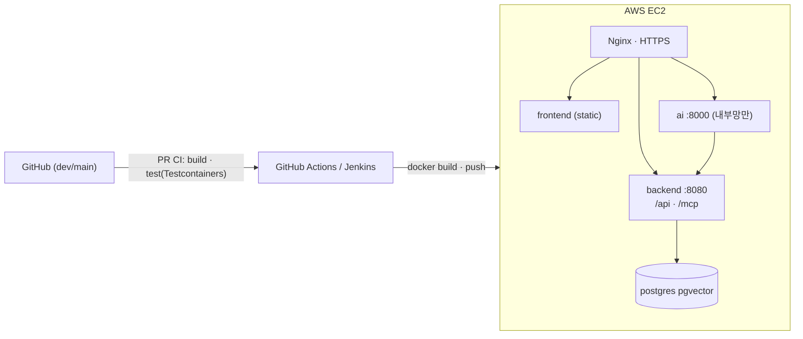

# BEEZ 시스템 아키텍처 (초안 v0.2)

> 기준: 요구사항 명세서(10.21) MVP 항목 + 업무 분담안. 검토(POL) 항목은 제안값으로 적고 미결로 표시한다.
> 원칙: **backend가 진실의 원천**. ai는 텍스트·구조화·임베딩만 돌려주고 판정·상태 변경은 하지 않는다. 설계 확정은 사람(팀장)만.

## 1. 구성 요소

## 2. 경계와 통신

| 구간 | 프로토콜 | 인증 | 비고 |
|---|---|---|---|
| Claude Code → backend `/mcp` | MCP Streamable HTTP | `Authorization: Bearer <agent_token>` (프로젝트별 발급) | 요청마다 토큰 폐기·현재 멤버십 확인 (AGT-03, ACC-05·06, MEM-06) |
| 웹 → backend `/api/**` | REST + JSON(snake_case) | 세션 쿠키 (Spring Security) | 확정·승인 = **사람 세션 + 현재 LEADER**. 팀장의 에이전트 토큰도 승인 불가 |
| backend → ai `/v1/**` | REST, 동기 (짧은 생성) / 비동기(검증) | `Authorization: Bearer AI_INTERNAL_TOKEN`, `X-Request-Id` 전달 | 타임아웃·오류 시 backend가 ERROR/템플릿 처리(NFR-06·12) |
| 검증 워커 → ai `/v1/validate` | REST 동기 호출 (워커가 응답을 받아 저장) | 내부 토큰 | **검증용 콜백 없음.** 비동기 주체는 backend 하나 |
| 문서 파일 | SeaweedFS S3 bucket(로컬 Docker·배포 동일), backend만 접근 | – | `storage_key` + 원본 해시. 로컬은 Compose named volume, 실제 배포 환경/영속 볼륨은 인프라 적용 필요 |
| backend ↔ Postgres | JDBC (JPA + 네이티브 벡터 쿼리) | – | 스키마는 Flyway만. backend 외 접근 금지 |

## 3. 핵심 설계 결정

라벨: **확정** = 명세 확정 · **담당자 결정** = 명세가 담당자 결정으로 남긴 항목을 주관자(변준성)가 정함 · **합의 필요** = 팀 합의 전 제안.

| 결정 | 내용 | 라벨 · 관련 |
|---|---|---|
| D1 설계 항목 단위 | 설계 항목(design_item)이 ID·불변 버전을 가진다. 베이스라인 = `baseline_item`(항목 버전) + `baseline_document`(문서 버전) 스냅샷. 항목 본문은 `kind`별 구조 스키마(`schema_version`). 표시 키는 프로젝트 내 유니크, 발급은 backend | 담당자 결정 (POL-06), 스키마는 합의 필요 · DOC-07·08 |
| D2 비동기 관리 + 요청 내 규칙 검사 | 검증은 비동기로 관리하되, 규칙 검사만으로 끝나면 최초 응답 전에 완료될 수 있다. 판정은 규칙, AI는 finding 후보만 추가 (판정표는 02 참고) | 합의 필요 · MCP-11, POL-04·10 |
| D3 롤백 | 검증 STALE + 작업 상태별 복귀(시작 전 → 재검증 대기, 진행 중 → WAITING(REVALIDATION) 점유 유지, 완료·취소 → 이력만) | 담당자 결정 · MCP-11 |
| D4 참조 스냅샷 + 시작 게이트 | 검증마다 `validation_design_ref`(본 항목 버전·관련 계획 리비전). START = `project` 행 FOR UPDATE → 현재 리비전 PASS → 참조 버전 현재성 → 선행 완료 → 같은 항목 CHANGES 없음. 전역 baseline 번호는 비교하지 않음. READS끼리는 막지 않음 | 담당자 결정 · TRC-02, NTF-05, VAL-04, TSK-04, AC-05·06 |
| D5 무효화 범위 | 변경 항목의 이전 버전을 `validation_design_ref`에 가진 검증(CHANGES·IMPLEMENTS·READS)만 STALE. AI 추론 관계 제외 | 담당자 결정 · VAL-03, AC-07 |
| D6 멱등·재시도·늦은 결과 | 재사용은 설계 대조 결과만(입력 스냅샷 해시). 겹침은 매번 재확인. 재시도 = 새 `validation_run`. 큐는 LEASED 커밋 후 잠금 없이 AI 호출, lease 회수. 결과 반영은 `WHERE status='RUNNING' AND current_attempt=:attempt` | 담당자 결정 · AC-09·16, NFR-11 |
| D7 발행·무효화 원자성 | 발행 서비스(오서현)가 같은 트랜잭션에서 검증 영향 서비스(변준성) 호출. 실패 시 전체 롤백. 알림·타임라인도 같은 트랜잭션에서 저장하고 중복 키는 건너뜀([10 문서](10-notification-activity-contract.md)) | 합의 필요 · APR-03, NFR-04 |
| 완료 델타 | COMPLETED 요청에 계획 대비 변경 → 있으면 WAITING(REVALIDATION) 후 완료. `task_completion_report`(불변)로 저장. 자기 보고 기반 | 합의 필요 · AC-15 보완 |
| AI 실패 폴백 | 대화·설명 = 템플릿 허용(origin 기록) · 검증 = ERROR(자동 PASS 금지) · 파싱 = 실패 상태(빈 결과 저장 금지) · 영향 분석 = 명시 관계 처리는 먼저 수행 | 담당자 결정 · NFR-06·12 |
| 컨텍스트 | MVP `summary / detail`. `get_development_context` 결과는 불변 패킷으로 저장하고 계획 리비전이 참조. 개인 기록은 명시적 제출, 수정은 새 리비전(동시 수정 시 409). `kind=DECISION`은 승인 설계가 아님 | 합의 필요 (박상은 주관) · POL-02·03 |
| 비용 | 모든 LLM 호출 1행, 시도별 합산 | 담당자 결정 · VAL-05, MON-05 |
| 이벤트 | 메시지 브로커 없음. 테이블 + 중복 식별값 | 확정(업무 분담안 공통 약속) |

## 4. 배포 (전진 담당 — 참고)

## 5. 미결 (팀 결정 필요)

- D2가 MCP-11을 만족한다는 해석, PASS 판정표
- D1 항목 본문 스키마 (API 계약·데이터 계약·정책)
- D7 서비스 간 트랜잭션 계약
- DEPENDS_ON 추적 깊이 (제안 1단계)
- 검증 타임아웃·재시도·lease 길이, 보고 끊김 임계값 (AC-09·14, POL-09)
- 임베딩 모델·차원 N, 문서 파일 형식·용량 (DOC-01), MCP 도구 분리·명칭 (MCP-10·12)
