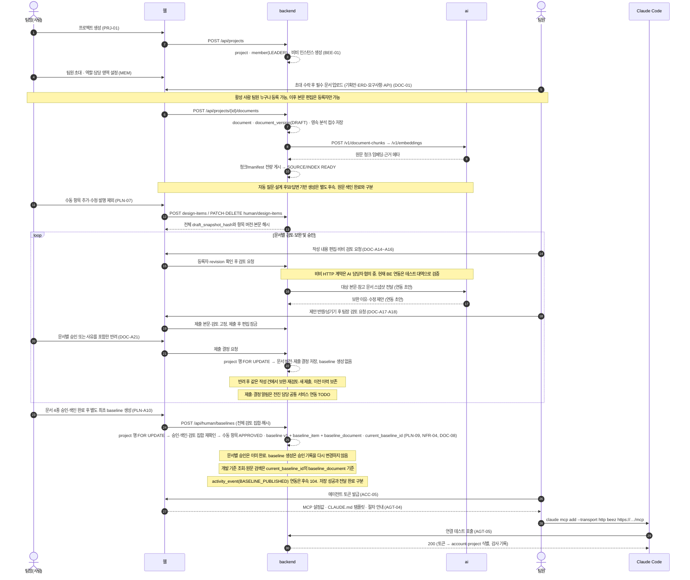
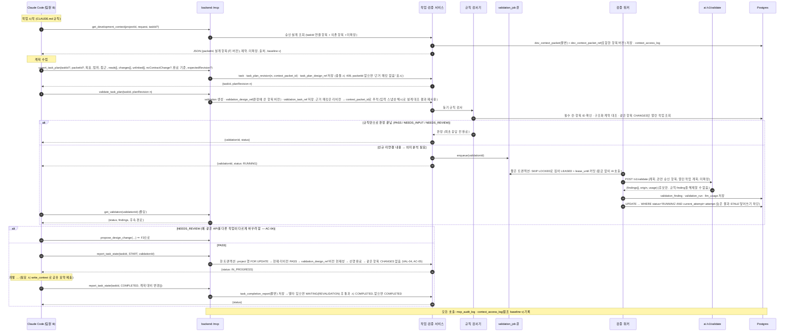
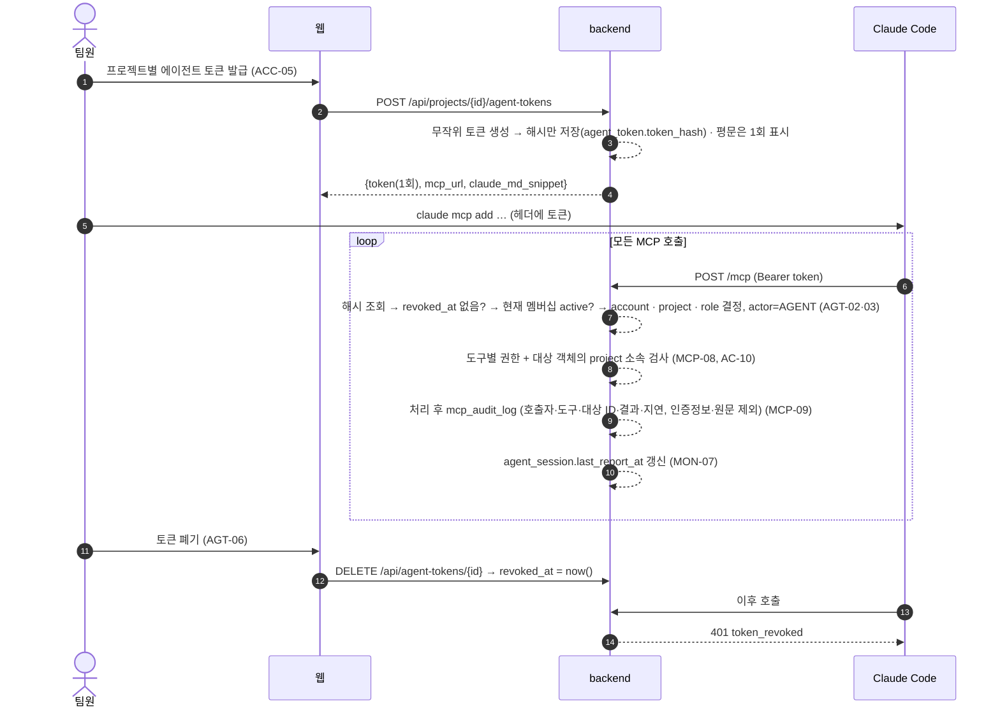

# BEEZ 시스템 플로우 (초안 v0.2)

핵심 검증·변경 흐름은 넷이다(비비 대화·역할 추천·벡터 검색·텍스트 회의 분석도 MVP지만 이 넷 위에서 동작한다). F2가 핵심 가치이고 데모 대상이다.

## F1. 온보딩 → 기준 설계 v1 발행 (PRJ · PLN · DOC · MEM · AGT)

## F2. 작업 계획 → 사전 검증 → 시작 → 완료 (TSK · VAL · MCP-10~12) — 핵심

상태 요약

| 개체 | 상태 |
|---|---|
| task | DRAFT → READY(계획 저장) → IN_PROGRESS(PASS 후 START) ↔ WAITING → COMPLETED / CANCELLED. `waiting_reason`: 보완 · 승인 대기 · 선행 작업 · 재검증 (제안, TSK-03) |
| validation | NOT_RUN → RUNNING → PASS / NEEDS_INPUT / NEEDS_REVIEW / ERROR, 어느 상태에서든 → STALE |
| change_proposal | PROPOSED → IN_REVIEW → APPROVED → PUBLISHED, 또는 REJECTED. PROPOSED/IN_REVIEW/REJECTED는 작성자가 WITHDRAWN으로 거둘 수 있음 |

PASS 판정표 (D2, 합의 필요)

| 상황 | 결과 | 판정 주체 |
|---|---|---|
| 필수 칸 누락, 모르는 항목 ID, changes·noContractChange 모두 비어 있음 | NEEDS_INPUT | 규칙 |
| 구조화된 계약의 명확한 불일치 | NEEDS_REVIEW | 규칙 (AI가 해제 불가) |
| 같은 항목을 CHANGES하는 열린 작업 | NEEDS_REVIEW | 규칙 |
| 신규·미연결 내용의 의미 해석 필요 | RUNNING → AI 분석 | AI는 finding 후보만 추가 |
| 위에 해당 없음, AI 분석 불필요 또는 완료 | PASS | 규칙 |
| 분석 실패·시간 초과 | ERROR | 규칙 |

복귀 경로

| 상황 | 처리 |
|---|---|
| NEEDS_INPUT | 계획 보완 → 새 리비전 → 재검증 |
| NEEDS_REVIEW | 계획 수정 또는 변경 제안(F3) → 발행 후 재검증 |
| ERROR | 자동 통과 없음. 명시적 재시도 → 새 validation_run |
| START 거부 | 사유 반환(오래된 참조·선행 미완료·겹침) |
| 진행 중 계획 수정 | 새 리비전 → 기존 PASS STALE → WAITING(REVALIDATION), 점유 유지 |
| 보고 끊김 | "상태 확인 필요" 표시만, 팀장이 수동 중단 또는 인계 (AC-11·14) |
| 취소 | 대기 job 취소, 점유 해제 |
| 선행 작업 순환 | 등록 시 거부 |

## F3. 설계 변경 제안 → 승인 → 발행 → 영향 전파 (CHG · APR · NTF)

```mermaid
sequenceDiagram
  autonumber
  participant CB as Claude Code (B)
  participant B as backend
  participant A as ai
  actor R as 관련 담당자 (A)
  actor L as 팀장
  participant CA as Claude Code (A)

  CB->>B: propose_design_change(baseline v3, 항목 API-07 before/after, 사유, taskId, validationId) (MCP-04)
  B-->>B: change_proposal(PROPOSED, base=v3) · 불변 revision/hash · 항목 투영 · 문서 기준/제안 버전 연결
  Note over CB,B: 195: 제출 후 잠금. 원문만 변경 가능. 제출만으로 baseline·작업 상태를 바꾸지 않음
  B->>A: POST /v1/impact (변경 항목, 명시적 관계, 열린 작업)  (BEE-06·09)
  A-->>B: 영향 후보 · 담당자 후보 · 근거
  B-->>B: 직접 참조 관련자 후보 조회 (task_plan_design_ref 기준, NTF-02)
  Note over B: 196·198: 알림·타임라인은 공통 서비스 사용. 직접 INSERT 없음
  R->>B: 의견 등록 / 검토 (MTG-01·02)
  opt 반려 후 보완
    L->>B: 반려 사유·검토한 revision/hash 제출 (198)
    B-->>B: 리비전별 REJECTED 결정 보존
    CB->>B: 같은 제안 번호로 보완 최종본·expected_revision/hash 재제출 (CHG-A04)
    B-->>B: 이전 내용 유지·다음 불변 리비전·PROPOSED, 재검토
  end
  L->>B: 승인 (사람 세션 + 현재 LEADER, 검토한 revision/hash) (APR-01, 198)
  B-->>B: project 행 FOR UPDATE → APR-05: 검토 리비전/hash 및 현재 baseline 대조, 다르면 409
  Note over CB,B: 검토 중 수정 불가. 기준 갱신이 필요하면 사유를 포함해 반려한 뒤 새 리비전으로 재제출
  B-->>B: 같은 트랜잭션: 새 항목·문서 버전 · baseline v4 + baseline_item · baseline_document · proposal PUBLISHED · approval 이력 (APR-03·04, NFR-04·05)
  B-->>B: 같은 트랜잭션에서 검증 영향 서비스 호출: 변경 항목 이전 버전을 validation_design_ref에 가진 검증 STALE · 진행 중 task WAITING(재검증) (VAL-03, D7)
  B-->>B: 같은 트랜잭션: 공통 알림·활동 저장(CHANGE_PROPOSAL_PUBLISHED·REVALIDATION_REQUIRED, 10 문서)
  Note over CA: 팀원 A의 에이전트, 다음 호출 시
  CA->>B: report_task_state(…) 또는 get_design_changes(sinceVersion=3) (MCP-03, NTF-04)
  B-->>CA: {변경 항목 API-07 v2, 영향: 내 검증 STALE, 조치: 계획 수정 후 재검증}
  CA->>B: upsert_task_plan(…) → validate_task_plan(…)  ⇒ F2 재진입
```

## F4. 에이전트 연결 · 인증 · 감사 (ACC-05 · AGT · MCP-08·09 · NFR-01~03)

## 비기능 흐름 메모

- 검증 재사용: 입력 스냅샷(계획 리비전 + 참조 항목 버전 + 규칙·분석기 버전) 해시가 같으면 설계 대조 결과 재사용(AC-16). 다른 작업과의 겹침은 재요청·START 때 항상 재확인.
- 응답 유실: `report_task_state(START)` 는 같은 `(task_id, validation_id)` 재요청에 같은 결과를 돌려준다(AC-09).
- 큐: `SKIP LOCKED` 는 경쟁 감소일 뿐 정확히 한 번 실행을 보장하지 않는다. lease 만료 회수 + attempt 조건부 반영으로 보완.
- 보고 끊김: `agent_session.last_report_at` 임계값 초과 시 "상태 확인 필요"만. 자동 완료·해제 없음(AC-14).
- 우회 작업: BEEZ를 거치지 않은 작업은 "검증 없음"으로 표시. 차단했다고 표시하지 않음(AC-12).

### 변경 제안 거두기와 발행 경계 (195)

CHG-A15는 프로젝트 잠금·작성자·revision/hash를 검사하고 WITHDRAWN과 행위자/시각을 저장한다. 원문·이전 제출은 보존하며 baseline·작업 상태는 바꾸지 않는다. 반려는 같은 번호의 새 revision, 거둔 제안은 previous_proposal_id를 연결한 새 제안이다.

최초 baseline은 PLN-A10 별도 동작이다. 후속 공식 승인·발행은 198의 공통 서비스에서 문서/항목·baseline·현재 포인터 및 합의된 관계/검증 처리를 같은 트랜잭션으로 연결한다. 문서 직접 승인·회의 종료 진입점은 별도 계약 확정 후 연결한다. 승인 전 제안 분석과 승인 후 최신 기준 재분석은 구분하며 후보 저장·최신성은 197, 관계 계산/저장은 해당 담당 서비스다. AI/CDC 외부 처리는 발행 잠금 안에서 수행하지 않는다.

### 문서 변경 제출과 색인 (195)

after_content로 제출한 문서 변경도 업로드한 DRAFT와 같이 문서 버전이 된다. 원문은 DB 트랜잭션 밖에서 먼저 저장소에 올리고, 제안·리비전·문서 버전·색인 작업·멱등 응답은 한 DB 트랜잭션으로 저장한다. 실패하면 올린 원문을 삭제한다. 그래서 모든 문서 변경에는 제안에 연결된 버전이 있고, 후속 발행(CHG-A09)은 한 가지 규칙으로 색인 상태를 확인할 수 있다. 확인과 발행은 198 담당이다.
